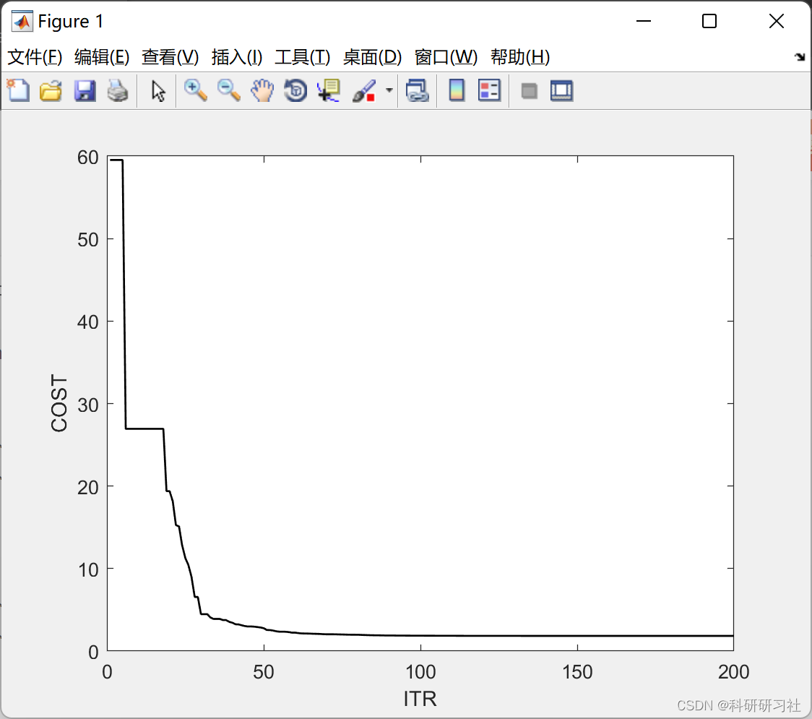
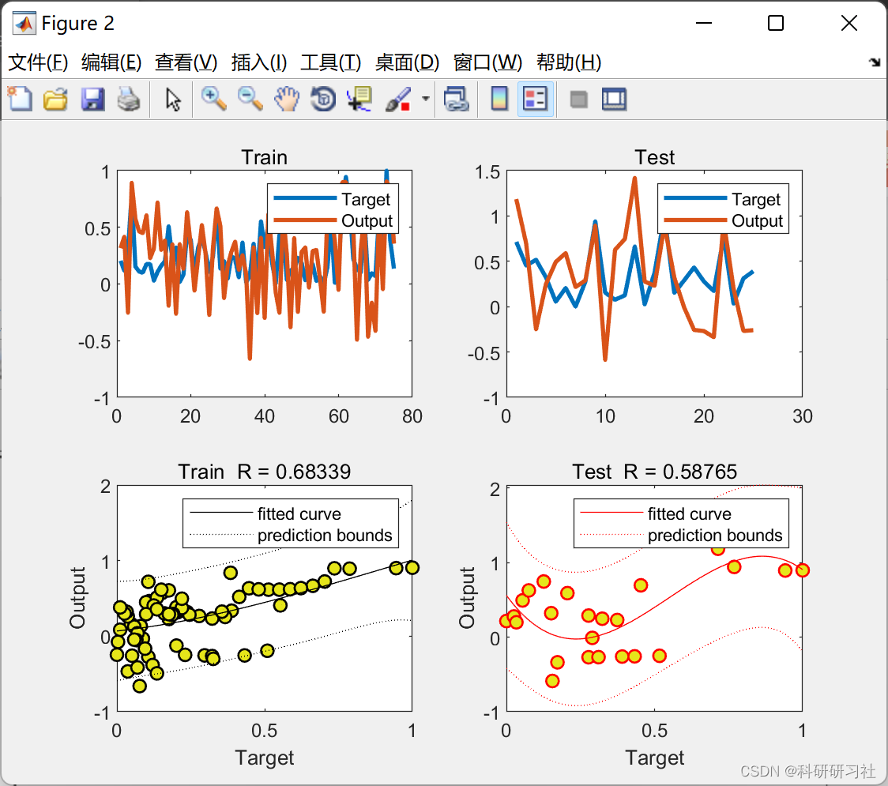
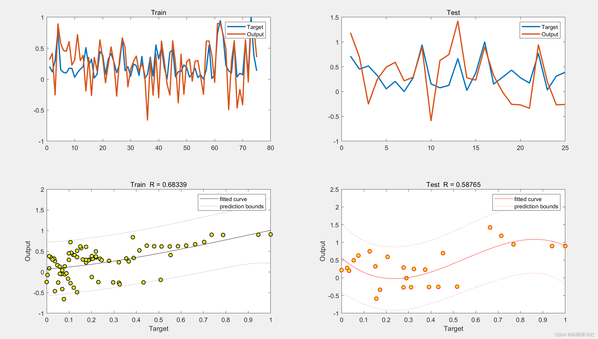

# Research on Neural Network Prediction Based on Cultural Algorithm Optimization (Matlab Code Implementation)

1. Cultural optimization algorithm
In nature, various organisms compete for survival in their environments, with the fittest evolving and adapting to the environment. People carefully observe the miraculous natural world, inspiring endless imagination. They simulate the evolutionary mechanisms of organisms, proposing a series of evolutionary computation methods such as evolutionary programming, genetic algorithms, particle swarm optimization algorithms, and fish swarm algorithms. However, these methods still operate within the population space, utilizing only current or previous evolutionary information, without fully exploiting the historical knowledge and effective predictions during the evolutionary process. Therefore, how to extract effective information and effectively utilize the various types of information hidden during the evolutionary process to improve efficiency has become a research hotspot in this field. Culture represents the entire human group's mode of production and life processes through symbols, values, and social norms, symbolizing the structural accumulation of knowledge; culture is also about education and humanity. Human beings have evolved at an unprecedented rate compared to all other species, leading to today's highly developed civilization. Without culture, there would be no experience to learn from, and society would continue to wander aimlessly in repeated trial-and-error.
Cultural algorithms simulate both biological evolution and cultural evolution from two levels, with both processes independent yet interrelated, representing a double-layered evolutionary system based on knowledge. The advantage of this algorithm lies in its ability to extract effective information from each search and guide the population's search process, effectively enhancing both precision and efficiency.
2. Artificial Neural Networks
Artificial neural networks can perform classification and regression tasks under supervised and unsupervised conditions. By adjusting weight coefficients appropriately, the output of the neural network converges to the correct target. These weight coefficients are learned through the training process, which involves analyzing a batch of data provided by the network to identify the underlying patterns between input and output. Subsequently, the output data of the network is calculated based on these patterns. Artificial neural networks have the following main characteristics:
(1) Higher learning ability.
(2) Capable of effectively simulating human thought and perception processes;
(3) Possesses strong association and error-tolerance capabilities;
(4) Possesses good parallel collaborative processing abilities;
(5) Is a nonlinear dynamic system.
3 The Matlab code and detailed article are only presented in part here, the full code and detailed articles can be found in:
Research on Neural Network Prediction Optimized by Cultural Algorithm (Matlab Code Realization).
function Culture = AdjustCulture(Culture, spop)\nn = numel(spop);\nnVar = numel(spop(1).Position);\nfor i = 1:n\nif spop(i).Cost<Culture.Situational.Cost\nCulture.Situational = spop(i);\nend\nfor j = 1:nVar\nif spop(i).Position(j)<Culture.Normative.Min(j) ...\n|| spop(i).Cost<Culture.Normative.L(j)\nCulture.Normative.Min(j) = spop(i).Position(j);\nCulture.Normative.L(j) = spop(i).Cost;\nend\nif spop(i).Position(j)>Culture.Normative.Max(j) ...\n|| spop(i).Cost<Culture.Normative.U(j)\nCulture.Normative.Max(j) = spop(i).Position(j);\nCulture.Normative.U(j) = spop(i).Cost;\nend\nend\nend\nCulture.Normative.Size = Culture.Normative.Max-Culture.Normative.Min;\nend\n  
Editor
4. Research on Neural Network Prediction Optimized by Cultural Algorithm (Matlab Code Implementation) - Edited
Edited
Edited
5. References
[1] Wei Xiu. Research on Optimizing RBF Neural Networks with Cultural Algorithm and its Application [D]. Taiyuan University of Technology, 2011.

## Images

<!-- PAYMENT_BLOCK -->

## Get this dataset

- Payment link (Stripe): [Buy now](https://buy.stripe.com/3cs8yP7sY87d0vu9AB)
- Payment QR code: 

<!-- /PAYMENT_BLOCK -->
